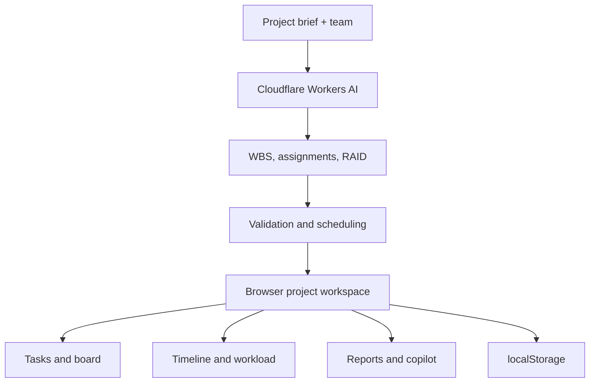

# AI Project Manager Assistant

[](https://ai-project-manager-assistant.madanmohanlearning.workers.dev/)
[](https://workers.cloudflare.com/)
[](https://www.typescriptlang.org/)

**Turn a project brief and a team list into a delivery plan: a work breakdown, assignments the model proposes from the roles and skills you enter, a dependency-checked schedule, milestones, a workload view, a RAID register, and an executive status report, plus a project-aware copilot.**

**[Try the live demo →](https://ai-project-manager-assistant.madanmohanlearning.workers.dev/)**

---

## The problem

Getting from a project brief to an executable plan takes several rounds of task breakdown, sequencing, ownership, and risk analysis, usually spread across documents, spreadsheets, and a board. For a new or small team, that set-up work delays delivery and is easy to skip.

## Who it is for

Project managers, Scrum Masters, and team leads kicking off small software or IT projects, and anyone learning to structure a plan (WBS, dependencies, RAID).

## Approach: the AI proposes, deterministic code decides

1. A Cloudflare Workers AI model (default `@cf/meta/llama-3.1-8b-instruct-fp8`) is asked to draft 10–24 tasks in 3–6 epics, with acceptance criteria, priorities, assignments, and RAID entries. The worker keeps the plan when at least 5 tasks survive normalization, and it stores at most 40.
2. The Worker then **normalizes task IDs, drops invalid or forward-pointing dependencies, calculates start and end days, and derives milestones and workload**. An assignee is kept only when the name is on the team; otherwise the worker round-robins across the team. The plan stays structurally consistent even when model output varies.
3. The browser workspace lets the PM review the plan and change task status. The copilot answers questions about the current plan but never changes it.

## What exists today

A deployed single-Worker app (TypeScript Worker + vanilla JS front end) with plan generation, a task table and board, a timeline, a workload view, a RAID register, an executive report, JSON export, and a copilot. There are **no automated tests or CI yet**, and no usage data from real projects.

## How I would measure it (not yet measured)

- Time from brief to a reviewed, team-accepted plan vs. doing it manually.
- Share of generated tasks and dependencies kept after PM review.
- Share of RAID items that get an owner and mitigation.

## Before you generate a plan

Use a brief with a concrete outcome, target date, and named team roles. Review dependencies, estimates, and RAID ownership before treating the plan as a commitment. The scheduler validates structure; it does not prove estimates are realistic or capacity is sufficient. Start and target dates are stored and sent to the model. Task placement uses day numbers, not those calendar dates.

For code review, start with the [Worker planning and copilot routes](src/index.ts), then [browser behavior](public/app.js).

## Key features

| Area | What it provides |
| --- | --- |
| AI planning | A prompted WBS of about 10–24 tasks in epics, with acceptance criteria, priorities, and assignments. The worker enforces a floor of 5 tasks and a cap of 40. |
| Scheduling | Normalized task IDs, invalid and forward-pointing dependencies removed, and deterministic start/end days |
| Delivery tracking | Task table, status controls, progress metrics, and a five-column board |
| Milestones | One planned milestone per epic, on the latest task end day in that epic |
| Team planning | Assignee names checked against the team you entered; task-day totals and workload share |
| RAID | Risks, assumptions, issues, dependencies, owners, severity, and mitigation |
| Reporting | Executive status summary, clipboard copy, and complete JSON export |
| AI copilot | A text answer about the supplied project (risks, dependencies, workload, recommended actions). It does not change the plan. |
| Persistence | Browser `localStorage` under the key `apm-projects-v3` |

Acceptance criteria are stored on each task and included in the JSON export. The task table does not render them.

## How it works



The AI proposes the plan, but it does not control the final schedule. The Worker normalizes task IDs, drops invalid or forward-pointing dependencies, calculates start and end days, and derives milestones and workload. This keeps the generated plan structurally consistent even when model output varies.

## Tech stack

- [Cloudflare Workers](https://developers.cloudflare.com/workers/)
- [Cloudflare Workers AI](https://developers.cloudflare.com/workers-ai/)
- TypeScript 5.9 (`typescript` `^5.9.2`; the lockfile resolves 5.9.3)
- Vanilla JavaScript, HTML, and CSS
- Browser `localStorage`
- Wrangler 4 (`wrangler` `^4.123.0`)

## Getting started

### Prerequisites

- Node.js 22 or later (Wrangler 4.123 requires `node >= 22`)
- npm
- A Cloudflare account with Workers AI access

### Run locally

```bash
git clone https://github.com/MadanMohan0537/ai-project-manager-assistant.git
cd ai-project-manager-assistant
npm install
npx wrangler login
npm run dev
```

Open the local URL printed by Wrangler, normally `http://localhost:8787`.

### Validate the project

```bash
npm run check
```

This runs `tsc --noEmit` and `wrangler deploy --dry-run`. TypeScript checking covers `src/**/*.ts` only. There is no test suite. The dry run checks the Worker bundle; it does not publish.

## Deployment

Publish the Worker to Cloudflare Workers:

```bash
npx wrangler login
npx wrangler deploy
```

`npx wrangler deploy` uploads the Worker defined in `wrangler.jsonc`. The Worker name stays `ai-project-manager-assistant`, so the live URL stays [https://ai-project-manager-assistant.madanmohanlearning.workers.dev/](https://ai-project-manager-assistant.madanmohanlearning.workers.dev/).

That config sets:

- Entry point: `src/index.ts`
- `workers_dev`: `true`
- `AI` — Workers AI binding
- `ASSETS` — static files from `public/`, with `/api/*` routed to the Worker first
- `AI_MODEL` — text variable, default `@cf/meta/llama-3.1-8b-instruct-fp8`

No Worker secrets are configured. Planning and the copilot use the `AI` binding on the Cloudflare account you deploy to. Change `AI_MODEL` in `wrangler.jsonc` to use another compatible Workers AI text model. If that variable is unset, the Worker uses the same default model name.

`npm run deploy` runs `wrangler deploy` as well.

## Using the app

1. Select **New project**.
2. Enter the project name, objective, description / requirements, start and target dates, methodology, technology stack, and constraints.
3. Add team members with their names, roles, skills, and capacity percent.
4. Select **Generate project workspace**.
5. Review tasks on **WBS & Tasks** or **Board**. Status is the only task field those views can change.
6. Inspect **Timeline**, **Team** (workload and profiles), **RAID**, and the executive status report on **Reports**.
7. Open **AI Copilot**. The panel title is Project Copilot. It answers questions about the open project.
8. Use **Export** or **Download JSON** for the complete project state.

## API

All `/api/*` responses use JSON.

### Health check

```http
GET /api/health
```

Returns runtime identity. It does not return the configured model.

```json
{
  "status": "ok",
  "service": "AI Project Manager Assistant",
  "runtime": "Cloudflare Workers",
  "version": "3.0.0"
}
```

`version` is the string hardcoded in `src/index.ts`. `package.json` is `"2.0.0"`.

### Generate a project plan

```http
POST /api/projects/plan
Content-Type: application/json
```

Example request:

```json
{
  "name": "Customer Analytics Platform",
  "objective": "Launch an analytics platform for support leaders.",
  "description": "Build ingestion, authentication, dashboards, filters, and reporting.",
  "startDate": "2026-08-20",
  "targetDate": "2026-09-20",
  "methodology": "Agile",
  "stack": "TypeScript, Cloudflare Workers, D1",
  "constraints": "Small team and a fixed beta date.",
  "team": [
    {
      "name": "Alice",
      "role": "Frontend Engineer",
      "skills": "TypeScript, UI engineering, design systems",
      "capacity": 100
    }
  ]
}
```

The response is `{ "project", "model" }`. `project` includes the normalized tasks (with `start_day` and `end_day`), milestones, RAID entries, workload, summary, and insights. `model` is the Workers AI model name used for that request. If `team` is empty or missing, the worker substitutes three default members (Alice, Bob, and Carol).

> `POST /api/run` remains available as a backward-compatible alias of `POST /api/projects/plan`.

### Ask the project copilot

```http
POST /api/copilot
Content-Type: application/json
```

```json
{
  "question": "What is most likely to delay this project?",
  "project": {
    "id": "project-id",
    "name": "Customer Analytics Platform",
    "tasks": [],
    "raid": []
  }
}
```

The copilot uses the supplied project state and returns `{ "answer": "..." }`. It does not mutate project data.

## Project structure

```text
.
├── public/
│   ├── app.js          # Browser state, rendering, and interactions
│   ├── index.html      # Application shell
│   └── styles.css      # Workspace UI, including narrow-viewport layout
├── src/
│   └── index.ts        # Worker routes, AI prompts, validation, and scheduling
├── package.json
├── package-lock.json
├── tsconfig.json
└── wrangler.jsonc      # Cloudflare bindings and deployment configuration
```

## Data and privacy

Projects are stored in the current browser's `localStorage` (`apm-projects-v3`). They are not synchronized across browsers, devices, or users. Project context is sent to Workers AI when generating a plan or asking the copilot a question.

For a multi-user production deployment, add authentication and server-side persistence such as Cloudflare D1 with per-user project ownership.

## Current limitations

- Project persistence is browser-local and account-free.
- After generation, the UI can change task status only. Titles, descriptions, acceptance criteria, estimates, assignees, dependencies, RAID items, and team details are not editable there.
- Acceptance criteria are kept on each task and in the JSON export; the task table does not show them.
- Board cards use status selectors instead of drag-and-drop.
- The timeline is dependency-aware day offsets. It is not a calendar schedule, and it is not a critical-path or PERT engine.
- Capacity is displayed for planning context. The scheduler does not level resources, and it does not match skills itself.
- Copilot suggestions must be applied manually. There is no control that writes an answer back into the plan.
- Automated tests and CI are not included.

## Roadmap ideas

- Cloudflare D1 persistence and authentication
- Shared team workspaces and role-based access
- Drag-and-drop board interactions
- Resource-levelled scheduling and critical-path analysis
- Import/export integrations for common project-management tools
- Automated tests and CI validation

## Built with

Cloudflare Workers, Workers AI, TypeScript, and Wrangler. The GitHub repository description still says this project is built with LangGraph. This codebase does not use LangGraph.

## License

No license file is included yet; add one before others reuse the code.
